# TUM Campus Heilbronn News & Events Aggregator

A scalable, **zero-AI-cost** software engineering foundation that scrapes publicly available events relevant to **TUM Campus Heilbronn** students, stores and normalises them in a **PostgreSQL** relational database controlled by SQL ingestion and filter functions, runs deterministically inside **Docker**, and serves a **React Native** client and **Google Firebase** deployment.

---

## 1. System Architecture

The repository is organized around two core backend folders:

1. **[`parsers/`](./parsers)** — Extensible, deterministic Python scraper framework & background daemon (`chn_parsers`), featuring the production two-stage parser for [`https://chn.tum.de/events`](https://chn.tum.de/events).
2. **[`database/`](./database)** — PostgreSQL relational schema (`core`), transactional ingestion stored procedures (`ingest`), SQL filter/search read layer (`api`), stateless HTTP JSON gateway (`api_server.py`), and typed React Native client SDK (`client/chnApiClient.ts`).

```mermaid
flowchart LR
    subgraph Web["Public Web Sources"]
        CHN["https://chn.tum.de/events<br/>(Listing + Detail Pages)"]
        FUT["Future Sources<br/>(Copy _template.py + @register)"]
    end

    subgraph Parsers["1. parsers/ (Docker Daemon / Cron)"]
        HTTP["HttpClient<br/>(Rate Limit + robots.txt)"]
        TUM["TumChnEventsParser<br/>(JSON-LD + SVG Meta + HTML)"]
        MOD["Event Dataclass<br/>(Validation + ISO-8601 TZ)"]
        SINK["PostgresSink / JsonSink"]
    end

    subgraph DB["2. database/ (PostgreSQL 16)"]
        ING["ingest.* SQL Functions<br/>(start_run / upsert_event / finish_run)"]
        CORE["core.* Tables<br/>(sources, scrape_runs, events, tags, event_tags)"]
        API_SQL["api.* Read Layer<br/>(search_events, count_events, tags, sources)"]
        GW["api_server.py<br/>(Stateless JSON Gateway :8080)"]
    end

    subgraph Clients["Clients & Cloud"]
        RN["React Native App<br/>(chnApiClient.ts)"]
        FB["Google Firebase Hosting<br/>(/api/** -> Cloud Run)"]
    end

    CHN --> HTTP --> TUM --> MOD --> SINK
    FUT -.-> HTTP
    SINK -->|"SELECT ingest.upsert_event()"| ING --> CORE --> API_SQL --> GW
    GW --> RN
    GW --> FB
```



---

## 2. Repository Layout

```text
CampusHeilbronnNewsParcer/
├── docker-compose.yml                         # Full 4-service stack: postgres, migrate, parsers, api
├── firebase.json                              # Firebase Hosting config + /api/** Cloud Run rewrite
├── .firebaserc                                # Firebase project binding
├── .env.example                               # Environment variable template
├── README.md                                  # Master architecture documentation
│
├── parsers/                                   # [FOLDER 1] Deterministic Web Parsers & Daemon
│   ├── Dockerfile                             # Container image for the scraper daemon / job
│   ├── pyproject.toml                         # Package dependencies & entry point
│   ├── README.md                              # Deep-dive parser documentation & how-to guide
│   ├── chn_parsers/
│   │   ├── models.py                          # Validated `Event` contract & `.to_payload()`
│   │   ├── base.py                            # `BaseParser`, `item_guard`, `mark_incomplete`
│   │   ├── registry.py                        # `@register` plug-in discovery of `sources/*.py`
│   │   ├── http.py                            # Polite HTTP client (throttling, retries, robots.txt)
│   │   ├── sinks.py                           # `PostgresSink` (SQL `ingest.*`) & `JsonSink`
│   │   ├── runner.py                          # Executes a parser against a sink, tracks stats
│   │   ├── daemon.py                          # Interval scheduler daemon (SIGTERM-safe)
│   │   ├── cli.py                             # CLI (`list`, `run --dry-run`, `run`, `daemon`)
│   │   ├── sources/
│   │   │   ├── _template.py                   # Copy-paste template to add a new website
│   │   │   └── tum_chn_events.py              # Two-stage parser for https://chn.tum.de/events
│   │   └── utils/
│   │       ├── dates.py                       # EN/DE date & time-range regex parser
│   │       ├── html.py                        # BeautifulSoup, JSON-LD, OpenGraph helpers
│   │       └── _compat_soup.py                # Zero-dependency stdlib fallback when bs4 is absent
│   └── tests/                                 # Offline unit tests + real HTML fixtures
│
└── database/                                  # [FOLDER 2] PostgreSQL Schema, Filters & Read Gateway
    ├── migrate.sh                             # Transactional SQL migration runner
    ├── api_server.py                          # Read-only HTTP JSON gateway over `api.*`
    ├── Dockerfile.api                         # Container image for `api_server.py`
    ├── README.md                              # Deep-dive database & SQL documentation
    ├── migrations/
    │   ├── 001_core_schema.sql                # Relational tables, foreign keys, FTS tsvector
    │   ├── 002_ingest_functions.sql           # SQL ingestion: start_run, upsert_event, finish_run
    │   ├── 003_api_read_layer.sql             # SQL views & filter functions: search_events, etc.
    │   └── 004_roles_and_grants.sql           # Least-privilege roles: chn_ingest & chn_reader
    ├── scripts/
    │   ├── create_app_users.sql               # Creates login users for scraper & API
    │   ├── seed_sample_data.sql               # Offline seed script via `ingest.*` functions
    │   └── deploy_firebase_cloudrun.sh        # One-command Cloud Run + Firebase Hosting deploy
    ├── client/
    │   └── chnApiClient.ts                    # Typed TypeScript SDK for the React Native app
    └── public/
        └── index.html                         # Interactive web prototype served by Firebase Hosting
```

---

## 3. End-to-End Engineering Logic

### 3.1 Two-Stage Parsing of `https://chn.tum.de/events` (Zero AI)
Rather than using an LLM or headless browser, [`tum_chn_events.py`](./parsers/chn_parsers/sources/tum_chn_events.py) uses deterministic extraction across two stages:
1. **Listing Pages (`/events`, `/events?tx_solrevents[page]=2`, ...)**:
   - Extracts each `<article class="c-events-solr-list__item">`.
   - Uses TYPO3's internal record identifier (`data-document-id=".../tx_calendarize_domain_model_event/885"`) to form a stable `external_id` (`"calendarize-event-885"`).
   - Captures the title, detail page URL, teaser summary, thumbnail image, start date (`<time datetime="YYYY-MM-DD">`), audience tags (`General Public`, `Current Students`, `Campus`, `Company`), and venue (`svg[title]`).
2. **Event Detail Pages (`/event/event/<slug>`)**:
   - Opens each event's link to extract the full description and exact date/time range:
     - **JSON-LD (`schema.org/Event`)**: Reads `startDate`, `endDate`, and `location.name`.
     - **Meta Bar (`ul.events-detail-meta > li`)**: Matches items by SVG icon reference (`#icon-calendar`, `#icon-clock`, `#icon-poi`, `#icon-building`) so both English and German pages parse identically. Extracts multi-day ranges (`November 6, 2026 – December 10, 2026`) and start/end times (`11:30 am – 2:00 pm`).
     - **Full Description**: Extracts multi-paragraph text from `.events-detail-description .rte-content` and `.events-detail-content .c-textmedia__bodytext`.
     - **High-Res Image & Registration**: Extracts `<meta property="og:image">`, external registration links, or on-page TYPO3 Powermail registration forms (`main form.powermail_form`).

### 3.2 SQL-Controlled Ingestion & Referential Integrity (`database/migrations/`)
The scraper connects to PostgreSQL as `chn_scraper` (granted only the `chn_ingest` role) and calls three `SECURITY DEFINER` stored procedures in [`002_ingest_functions.sql`](./database/migrations/002_ingest_functions.sql):
- **`ingest.start_run(source_key, name, base_url)`**: Auto-registers the source in `core.sources` and opens an audit record in `core.scrape_runs`.
- **`ingest.upsert_event(run_id, event_jsonb)`**:
  - Computes `md5(p_event::text)` on the canonical `jsonb` payload.
  - Inserts new events, updates changed events, or simply touches `last_seen_run_id` / `last_seen_at` when content is unchanged.
  - Normalises tags through `core.slugify()` (e.g. `"Current Students"` $\rightarrow$ `"current-students"`) into `core.tags` and `core.event_tags`.
- **`ingest.finish_run(run_id, status, item_errors, error_message, complete)`**:
  - Soft-deletes (`is_active = false`) upcoming events that vanished from the source **only if** the run `succeeded`, saw the `complete` pagination, and saw at least 1 event. Past events remain in the database for historical queries.

### 3.3 SQL Filters & Full-Text Search (`003_api_read_layer.sql`)
The React Native app and HTTP gateway query PostgreSQL as `chn_api` (granted only the `chn_reader` role) via [`003_api_read_layer.sql`](./database/migrations/003_api_read_layer.sql):
- `api.search_events(p_from, p_to, p_tags, p_sources, p_query, p_limit, p_offset)` filters by time window (keeping ongoing multi-day exhibitions visible until their `ends_at`), tag slug overlap (`&&`), source keys, and weighted `tsvector` full-text search (`websearch_to_tsquery`).
- `api.tags` returns all tag chips with their live `upcoming_count`.
- `api.sources` returns every source with its latest run health and `upcoming_events` count.

---

## 4. Quickstart

### 4.1 Run Unit Tests & Dry-Run Scraper (No Docker or Database Required)
```bash
# Run the offline unit test suite (8 tests against real chn.tum.de HTML fixtures)
PYTHONPATH=parsers python3 -m unittest discover -v -s parsers/tests

# List registered parsers
PYTHONPATH=parsers python3 -m chn_parsers list

# Dry-run the live CHN parser and print normalised JSON to stdout
PYTHONPATH=parsers python3 -m chn_parsers run --parser tum_chn_events --dry-run
```

### 4.2 Run the Complete Stack in Docker
```bash
cp .env.example .env
docker compose up --build
```
This starts:
1. **`postgres`** on port `5432`.
2. **`migrate`**, which applies `001`–`004` migrations and creates `chn_scraper` and `chn_api`.
3. **`parsers`**, which immediately scrapes `https://chn.tum.de/events` and repeats every 6 hours.
4. **`api`**, which serves the JSON REST API on `http://localhost:8080`:
   - `GET http://localhost:8080/api/v1/events?tags=general-public&q=AI`
   - `GET http://localhost:8080/api/v1/tags`
   - `GET http://localhost:8080/api/v1/sources`
   - `GET http://localhost:8080/healthz`

---

## 5. React Native & Google Firebase Integration

### 5.1 React Native Client (`database/client/chnApiClient.ts`)
Import [`chnApiClient.ts`](./database/client/chnApiClient.ts) into your React Native / Expo project:
```ts
import { ChnEventsApiClient } from "./chnApiClient";

const api = new ChnEventsApiClient("https://tum-chn-events-proto.web.app");

const { total, items } = await api.listEvents({
  tags: ["current-students"],
  q: "workshop",
  limit: 20,
});
```

### 5.2 Deploying the Prototype to Google Firebase + Cloud Run
The repository includes [`firebase.json`](./firebase.json), [`.firebaserc`](./.firebaserc), an interactive web preview ([`database/public/index.html`](./database/public/index.html)), and [`database/scripts/deploy_firebase_cloudrun.sh`](./database/scripts/deploy_firebase_cloudrun.sh):
- **Firebase Hosting** serves the web UI and rewrites `/api/**` requests to the **`chn-api`** container on **Cloud Run** (`min-instances: 0`, scaling to zero when idle).
- **Cloud Run Jobs + Cloud Scheduler** execute the **`chn-parsers`** container (`python -m chn_parsers run`) on a schedule against your managed PostgreSQL instance (Cloud SQL, Neon, or Supabase free tier).

```bash
# Deploy containers to Cloud Run and Hosting to Firebase
GCP_PROJECT_ID=your-firebase-project-id \
GCP_REGION=europe-west3 \
  ./database/scripts/deploy_firebase_cloudrun.sh
```

